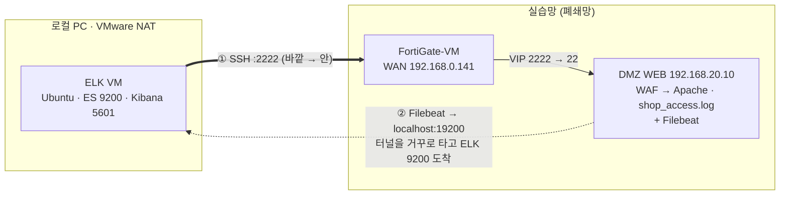

# ELK 구축 기록 — Shadow API 탐지용 로그 파이프라인

> 작성: YHC · 기준일: 2026-11-01
> [01 비교](01_Prometheus_vs_Kibana_비교.md) · [02 가이드](02_ELK_구축_가이드라인.md)에서 정한 내용을 실제로 구축한 기록과, Shadow API 탐지에 얼마나 적합한지 정리한다.
> `elastic` 비밀번호 · API 키 · SSH 키는 이 문서와 레포에 넣지 않는다.

---

## 1. 요약

- **목적**: 웹 액세스 로그를 OpenAPI 명세와 대조해 **Shadow / Zombie API를 요청마다 자동 분류**하고 대시보드로 보여준다.
- **구성**: Elastic **9.5.5** (Elasticsearch · Kibana · Filebeat), ELK VM은 로컬 PC VMware(NAT)
- **연결**: **SSH 역방향 터널** — 방화벽 정책 추가 없이 WEB의 로그를 ELK로 보낸다
- **현재**: ES · Kibana 설치 완료, 터널이 끊겨 **로그가 들어오지 않는 상태**

| 항목 | 상태 |
|---|---|
| Elasticsearch · Kibana 설치 | ✅ 완료 |
| SSH 역방향 터널 | ⚠️ 인프라 VM 종료로 끊김 |
| Filebeat (WEB) | ✅ 설치 / ⬜ 설정 전 |
| 파이프라인 `api-access` | ⚠️ 밀리초 시각 대응 필요 (6-1) |
| Kibana 대시보드 | ⬜ 미시작 |

---

## 2. Shadow API 탐지 원리

```
Shadow  = 관측된 엔드포인트(로그) − 명세(OpenAPI) 엔드포인트
Zombie  = 명세상 deprecated ∩ 관측
```

```
shop_access.log 한 줄
  → ① 파싱          메서드 · 경로 · 상태코드 · IP · 시각
  → ② 경로 정규화    /api/v1/users/17 → /api/v1/users/{id}
  → ③ 명세 대조      api-inventory (openapi_to_inventory.py 로 생성) 와 enrich
  → ④ 분류          api.classification = documented | shadow | zombie
  → Kibana
```

- 명세: `web/src/public/docs/openapi.yaml` → **`/api/v2/*`만 문서화** → `/api/v1/*` 호출은 로그에 찍히는 순간 `shadow`로 분류된다.
- 정규화 규칙은 `openapi_to_inventory.py`와 같은 `{id}` 규칙을 쓴다 → 명세와 로그가 같은 키로 맞춰진다.

---

## 3. Shadow API 탐지 적합성

### 3-1. 이 방식이 잘하는 것

| 필요한 것 | ELK 파이프라인 |
|---|---|
| 문서에 없는 경로 식별 | ✅ 명세와 **수집 시점에 자동 대조** (enrich) |
| 처음 보는 경로 | ✅ 명세에 없으면 패턴 없이도 `shadow` |
| ID가 붙은 경로 묶기 | ✅ ingest pipeline에서 `{id}` 정규화 |
| deprecated API 사용 (Zombie) | ✅ 명세 `deprecated: true` 반영 |
| 사후 조사 | ✅ 원문 보존 → "v1을 부른 요청 전부" 검색 |

### 3-2. 시그니처 룰만으로는 어려운 이유

Shadow API · BOLA 요청은 **문법상 정상**이다 (`200 OK`, 공격 문자열 없음).

- 룰은 **명세를 모른다** → "문서에 없는 경로"라는 기준 자체가 없다. 알려진 경로를 정규식으로 적어 두는 것만 가능하다.
- 룰은 **미리 적은 패턴만** 맞춘다 → 새 경로는 놓친다.
- 경로를 `{id}` 템플릿으로 묶지 않는다.
- OpenSearch 기반 인덱서에는 Elasticsearch의 **enrich가 없다** → 수집 시점 자동 태깅이 안 된다 (01 비교 5장).

→ 그래서 별도 ELK를 두고, 명세 대조를 파이프라인에 넣었다.

### 3-3. 이 방식의 한계

| 한계 | 내용 | 보완 |
|---|---|---|
| **수동(passive)** | 호출된 것만 보인다 → **열려만 있고 아무도 안 쓰는 API는 못 본다** | **API 스캐닝**(능동)으로 보완 |
| 명세 품질 의존 | 명세가 틀리거나 없으면 전부 shadow | 명세 없는 상태 = "명세 작성이 필요한 목록"으로 활용 |
| 정규화 한계 | 문자열 ID(`/users/alice`)는 안 묶임 → 오탐 | 패턴별 `gsub` 추가 |
| 정적 파일 · 페이지 | `/css/…`, `.php`도 잡힘 | 대시보드 필터 또는 `drop` |
| 클라이언트 IP 정확도 | IP가 도커 게이트웨이로 찍히면 IP별 분석이 깨진다 | 6-2 확인 |

---

## 4. 구축 구성

### 4-1. 토폴로지



- **①** ELK VM이 기존 SSH 포트포워딩(`:2222 → WEB:22`)으로 접속한다.
- **②** `-R` 옵션으로 WEB에 열린 포트로 보낸 데이터가 같은 SSH 연결을 거꾸로 타고 ELK에 도착한다.
- 방화벽 입장에서는 이미 허용된 SSH 한 줄뿐 → **새 정책이 필요 없다** (평가판 정책 수 한도 회피).

| WEB에서 | → | ELK VM | 용도 |
|---|---|---|---|
| `localhost:19200` | → | `localhost:9200` | Filebeat → Elasticsearch |
| `localhost:15601` | → | `localhost:5601` | Kibana 확인용 |

### 4-2. 구성 결정

| 결정 | 이유 |
|---|---|
| ELK를 **실습망 밖** VM에 | 실습망 호스트 PC 메모리 여유 부족 |
| **WEB에서 직접 수집** (Wazuh 경유 X) | 원본 로그가 WEB에 있음 · 운영 중인 Wazuh 서버 설정을 건드리지 않음 · Wazuh 상태와 무관하게 수집 |
| 터널 포트 **19200** | 9200(Wazuh indexer)과 혼동 · 충돌 방지 |
| **Logstash 미사용** | 파싱은 ES **ingest pipeline**이 담당. Logstash는 JVM이라 무겁고 오프라인 설치 대상이 늘어남 → 정확한 이름은 Elastic Stack (Filebeat + ES + Kibana) |
| 네이티브 패키지 · 오프라인 반입 | 폐쇄망, `.sha512` 검증 |

---

## 5. 작업 기록

| 날짜 | 작업 |
|---|---|
| 10/29 | 01 Prometheus vs Kibana 비교 · 02 ELK 구축 가이드(A/B/C 수집 경로) · `openapi_to_inventory.py` (PR #12) |
| 10/29 | ELK VM 준비 (Ubuntu 26.04.1 amd64 — Elastic 공식 지원 목록 외, 인지하고 진행), Elastic 9.5.5 선정 |
| 10/30 | Elasticsearch · Kibana 설치 · 설정, WEB에 Filebeat 설치 |
| 10/30 | 연결 방식을 **WEB 대상 SSH 역방향 터널**로 확정 |
| 10/30 | 인프라 VM 종료로 터널 끊김 → Metricbeat setup `context deadline exceeded` |
| 11/01 | 로그 미수집 원인 점검 → 밀리초 시각 · 클라이언트 IP 이슈 확인 (6장) |

### 설정

`/etc/elasticsearch/elasticsearch.yml`

```yaml
cluster.name: api-monitoring
node.name: elk-01
network.host: ["_local_", "_site_"]
```

- 힙: VM RAM의 절반 (`/etc/elasticsearch/jvm.options.d/heap.options`)
- Kibana: `server.host: "0.0.0.0"`, enrollment token 연결. ELK VM IP가 바뀌면 `server.publicBaseUrl`만 수정 (Filebeat는 `localhost:19200`을 보므로 영향 없음)

역방향 터널 (ELK VM에서)

```bash
ssh -p 2222 -N -o ServerAliveInterval=30 \
  -R 19200:localhost:9200 -R 15601:localhost:5601 \
  ubuntu@192.168.0.141
```

---

## 6. 현재 이슈

### 6-1. 로그 시각에 밀리초가 붙었다 → 파이프라인 날짜 처리 수정 필요

2026-10-29부터 Apache 로그 시각 형식이 바뀌었다 (`docs/troubleshooting/03`).

```
이전: [29/Oct/2026:10:51:41 +0900]
이후: [29/Oct/2026:10:58:35.232 +0900]
```

02 가이드의 `date` 프로세서는 이전 형식만 처리한다 → 날짜 단계에서 실패하면 `on_failure`로 빠져 **정규화 · 명세 대조 · 분류가 붙지 않는다.**

```json
{ "date": { "field": "access_ts",
            "formats": ["dd/MMM/yyyy:HH:mm:ss.SSS Z", "dd/MMM/yyyy:HH:mm:ss Z"] } }
```

- 확인: `_simulate`에 **밀리초가 붙은 줄**을 넣어 `api.classification`이 나오는지
- 운영 확인: Kibana에서 `error.message : *` 검색 → 많으면 이 문제

### 6-2. 클라이언트 IP가 도커 게이트웨이로 찍히는지 확인 필요

설계: 외부 → WAF(`172.30.0.10`, X-Forwarded-For 추가) → Apache(`mod_remoteip`, WAF만 신뢰) → 실제 IP 기록.
그런데 로그 예시에 **`172.30.0.1`(도커 게이트웨이 = 호스트)** 이 찍혀 있다.

| 가설 | 의미 |
|---|---|
| 일부 줄만 `.1` | 서버 안에서 `curl 127.0.0.1:8080`으로 WAF 없이 테스트한 요청 → 해당 줄만 제외 |
| 대부분이 `.1` | 포트 연결 단계에서 실제 IP가 사라짐 → **IP별 분석 전체가 깨짐**, v1 IP 제한(`172.16.0.0/12` 허용)도 무력화 |

```bash
# Apache가 본 IP 분포
awk '{print $1}' ~/sesac_shop_web_php/logs/apache/shop_access.log | sort | uniq -c | sort -rn | head
# WAF가 본 IP
ls ~/sesac_shop_web_php/logs/waf/
```

### 6-3. 레포와 서버의 로그 형식 불일치

서버의 `apache-vhost.conf`는 밀리초 형식으로 바뀌었지만 레포 `web/src/deploy/apache-vhost.conf`는 이전 형식(`%t`)이다 → 레포 기준으로 재배포하면 형식이 되돌아간다. 파이프라인은 **두 형식을 모두** 받도록 둔다 (6-1).

---

## 7. 다음 단계

1. 인프라 VM 재기동 → 터널 재연결
2. WEB에서 터널 확인 — `401`이면 정상

   ```bash
   curl -sk https://localhost:19200 -o /dev/null -w '%{http_code}\n'
   ```

3. 터널 상시화 — `autossh` + systemd (키 교환: `ssh-keygen -t ed25519` → `ssh-copy-id -p 2222 ubuntu@192.168.0.141`)

   ```ini
   # /etc/systemd/system/elk-tunnel.service
   [Unit]
   Description=Reverse SSH tunnel to WEB server
   After=network-online.target

   [Service]
   ExecStart=/usr/bin/autossh -M 0 -p 2222 -N \
     -o ServerAliveInterval=30 -o ExitOnForwardFailure=yes \
     -R 19200:localhost:9200 -R 15601:localhost:5601 \
     ubuntu@192.168.0.141
   Restart=always

   [Install]
   WantedBy=multi-user.target
   ```

4. `api-access` 파이프라인 날짜 형식 수정 (6-1) → `_simulate` 확인
5. 클라이언트 IP 확인 (6-2)
6. Filebeat 설정 · 기동 (02 가이드 6-AB, `hosts: https://localhost:19200`)
7. API 키 → `api-inventory` 적재 → enrich → 파이프라인 (02 가이드 4~5장)
8. Kibana Data View `filebeat-*` + **Shadow API 대시보드** — 첫 목표: `/api/v1/*`가 `shadow`로 분류되는 화면

### 단계별 점검표 (로그가 안 보일 때)

| 단계 | 확인 | 명령 |
|---|---|---|
| 원본 | 로그가 쌓이나, IP가 실제 IP인가 | `tail -3 …/logs/apache/shop_access.log` |
| 터널 | WEB에서 ES가 보이나 | `curl -sk https://localhost:19200 …` → `401` |
| Filebeat | 보내고 있나 | `sudo journalctl -u filebeat -n 50` |
| 파이프라인 | 파싱되나 | `_simulate`에 밀리초 줄 |
| 결과 | 분류가 붙었나 | Kibana `error.message : *` |

---

## 8. 보안 메모

- `ssh -R`은 기본값으로 WEB의 **localhost에만** 포트를 연다 (`GatewayPorts` 미설정) → 19200 · 15601은 WEB 밖에서 접근 불가
- Filebeat는 **쓰기 전용 API 키**로 연결 (02 가이드 4장) → WEB이 침해돼도 조회 · 삭제 불가
- 비밀값은 레포에 올리지 않는다
