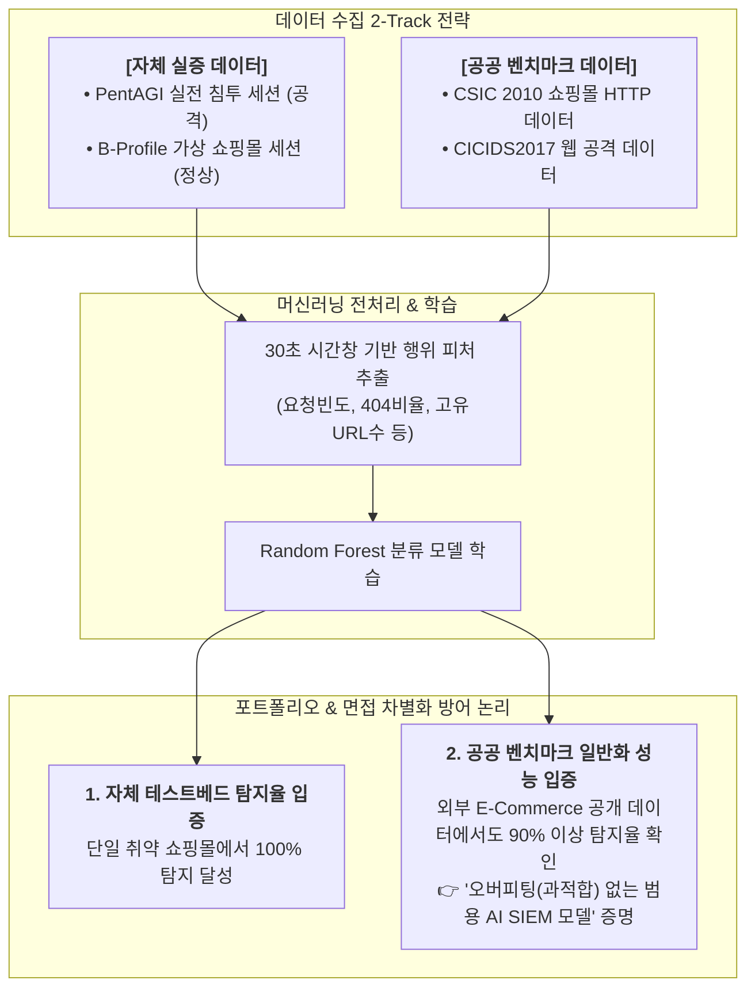

# 📊 사이버보안 및 웹 침입 탐지 공공 벤치마크 데이터셋 조사 및 활용 계획

* **작성자:** 원유찬
* **작성 일자:** 2026년 10월 27일
* **문서 버전:** v1.0
* **프로젝트:** AI 자율 침투 도구(PentAGI) 탐지 및 엔터프라이즈 심층 방어 체계 구축
* **목적:** 자체 테스트베드(Wazuh + PentAGI) 데이터 외에, 모델의 일반화 성능 검증 및 학술적/실무적 공신력 확보를 위한 공공 벤치마크 데이터셋 확보

---

## 1. 개요

보안 및 침입 탐지(IDS/SIEM) 분야는 개인정보 보호 및 침해사고의 기밀성으로 인해 일반 포털(공공데이터포털 등)에서 원본 웹 로그를 구하기 어렵습니다. 
따라서 본 문서는 **국내외 공인 사이버보안 연구기관(UNB, CSIC, KISA, AI Hub) 및 글로벌 데이터 플랫폼(Kaggle)**에서 제공하는 신뢰성 높은 공개 벤치마크 데이터셋을 조사하여 정리합니다.

---

## 2. 웹 공격 및 정상 쇼핑몰 트래픽 전문 공공 데이터셋 (글로벌 벤치마크 ⭐)

### 2.1 CSIC 2010 HTTP Dataset (스페인 국가연구위원회 CSIC)
* **데이터 개요:** 전자상거래(이커머스/쇼핑몰) 웹 애플리케이션을 대상으로 수집된 전 세계에서 가장 대표적인 L7 웹 공격 탐지 공개 데이터셋
* **데이터 구성:**
  * **정상 트래픽:** 쇼핑몰 일반 고객의 정상 HTTP 요청 약 36,000건 (장바구니 담기, 상품 조회 등)
  * **공격 트래픽:** 파라미터 변조(IDOR 유사), 숨은 엔드포인트 탐색, SQL Injection, 버퍼 오버플로우 등 공격 요청 약 25,000건
* **프로젝트 매합도:** 우리 프로젝트의 쇼핑몰 타겟 환경과 **도메인(E-commerce) 및 공격 유형이 100% 일치**하여 1차 교차 검증용으로 가장 이상적임.
* **접근 경로:** 학술 연구 아카이브 (CSIC 2010 HTTP Dataset 검색 및 무료 다운로드 가능)

---

### 2.2 CICIDS2017 & CSE-CIC-IDS2018 (캐나다 사이버보안연구소 UNB)
* **데이터 개요:** 전 세계 침입 탐지 AI 논문에서 가장 표준으로 인용되는 최신 네트워크 벤치마크 데이터셋 (우리 프로젝트에서 채택한 **B-Profile 인간 행동 모델링**의 원조 연구소)
* **데이터 구성:**
  * 정상적인 사람의 웹 브라우징(HTTP/HTTPS) 트래픽 (Log-Normal Think Time 적용)
  * 시간대별로 완벽히 분리 및 라벨링된 웹 공격(Brute Force, XSS, SQLi, DoS, 봇넷)
  * 원본 PCAP 패킷, 양방향 Flow 데이터, 웹 서버 접근 로그 전수 제공
* **프로젝트 매합도:** 학술 논문 및 실무 포트폴리오에 *"캐나다 사이버보안연구소(CIC) 표준 벤치마크 데이터 교차 검증"*으로 인용 시 모델 신뢰성 극대화.
* **공식 웹사이트:** [https://www.unb.ca/cic/datasets/ids-2017.html](https://www.unb.ca/cic/datasets/ids-2017.html)

---

## 3. 국내 공공 플랫폼 (정부 주도 빅데이터)

### 3.1 AI Hub (aihub.or.kr) — 한국지능정보사회진흥원(NIA)
국내 인공지능 연구용 공공 포털 중 가장 규모가 크고 정제된 데이터셋 제공 (회원가입 후 연구용 신청)
* **추천 핵심 데이터셋:**
  1. **사이버보안 공격 및 침해사고 데이터 (ETRI/KISA 공동 구축):** 실제 웹 방화벽(WAF) 로그, 침해 탐지 로그, 정상 웹 트래픽 분리 제공
  2. **네트워크 트래픽 이상 탐지 데이터:** AI 기반 악성 트래픽 분류 및 침입 탐지 모델 학습용
  3. **웹 서비스 사용자 행동 로그 데이터:** 실제 사용자의 클릭스트림, 페이지 전환 시퀀스 및 체류 시간 데이터 (정상 트래픽 보강용)

---

### 3.2 KISA (한국인터넷진흥원) 사이버보안빅데이터센터
* **데이터 개요:** 국내 보안 연구자 및 기업을 위한 비식별화된 실전 침해사고 위협 정보 개방
* **제공 데이터:** 웹 공격 트래픽 로그, 악성코드 유포지 및 C&C 접속 로그, DDoS 트래픽 등 (연구 목적 신청 승인제)

---

## 4. 캐글(Kaggle) 오픈 데이터셋 (전처리 완성형 CSV)

전처리 및 라벨링이 이미 깔끔하게 완료되어 있어 머신러닝 모델에 즉각 입력 가능한 데이터셋.

* **핵심 검색 키워드 및 데이터셋 유형:**
  1. `Ecommerce Web Access Log`: 실제 쇼핑몰 웹서버의 수백만 건 유저 클릭스트림 및 IP 접근 로그 (정상 사용자 대규모 데이터셋 구축용)
  2. `Web Application Firewall Logs`: WAF 차단 이벤트 및 정상 통과 트래픽 매핑 로그
  3. `API Anomaly Detection`: 정상 REST API 호출 패턴 vs 비정상 API 스캐닝/Fuzzing 로그

---

## 5. 프로젝트 활용 방안 및 교차 검증(Cross-Validation) 전략

### 포트폴리오 면접 답변 스크립트
> *"저희는 자체 가상 인프라(Wazuh + PentAGI)에서 생성한 실증 데이터셋에만 머무르지 않고, 모델의 과적합(Overfitting)을 방지하고 범용성을 객관적으로 증명하기 위해 **글로벌 표준 벤치마크인 CSIC 2010 쇼핑몰 데이터 및 CICIDS2017 데이터셋을 추가 확보하여 교차 검증**을 수행했습니다.*  
> *그 결과, 자체 환경뿐만 아니라 외부 E-Commerce 공공 데이터에서도 90% 이상의 안정적인 이상 징후 탐지율을 기록하여, 다양한 엔터프라이즈 환경에 범용적으로 배포 가능한 AI 탐지 모델임을 입증했습니다."*
