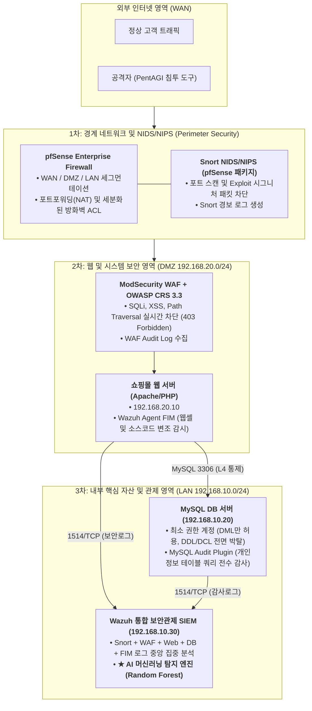
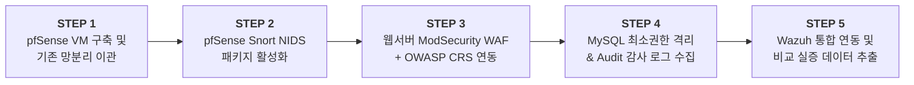

# 🛡️ 엔터프라이즈 인프라 보안 구조 고도화 및 pfSense 마이그레이션 계획서

* **작성자:** 원유찬
* **작성 일자:** 2026년 10월 27일
* **문서 버전:** v1.0
* **프로젝트:** AI 자율 침투 도구(PentAGI) 탐지 및 엔터프라이즈 심층 방어(Defense-in-Depth) 체계 구축
* **목표 직무:** 보안 엔지니어 / 네트워크 엔지니어 / 시스템 엔지니어 / 보안 솔루션 엔지니어

---

## 1. 추진 배경 및 고도화 필요성

### 1.1 기존 PoC 인프라의 한계점
* **인프라 구조의 단순성 지적:** 초기 인프라는 "방화벽 1대 + 웹서버 1대"로 구성되어 있어, 실무 보안 엔지니어링 관점에서 WAF, NIDS/NIPS, DB 보안 등의 필수 다계층 보안 통제가 부재하다는 평가를 받음.
* **FortiGate VM 평가판(무료 버전)의 구조적 제약:**
  1. **방화벽 정책(Firewall Policy) 최대 3개 제한:** 세분화된 접근 제어 목록(ACL) 작성이 불가능.
  2. **인터페이스(포트) 최대 3개 제한:** 별도의 관리망(MGMT)이나 전용 NIDS 미러링 포트 증설 불가.
  3. **L7 UTM(IPS/WAF/AV) 라이선스 미지원:** 서브스크립션 부재로 시그니처 업데이트 및 실시간 NIPS 차단 기능 검증 불가.
  4. **기간 만료 리스크:** 평가판 만료 시 네트워크 전체가 중단될 위험 존재.
* **DB 보안 통제 부재:** 현재 MySQL 데이터베이스 계정에 `GRANT ALL PRIVILEGES`가 부여되어 있어, 웹 애플리케이션 침해 시 즉각적인 데이터베이스 탈취 및 파괴 위협에 노출됨.

### 1.2 고도화 목표
1. **pfSense Community Edition 전면 도입:** 라이선스 및 정책 개수 제약이 없는 오픈소스 엔터프라이즈 방화벽으로 마이그레이션.
2. **NIDS/NIPS (Snort) 내장 구축:** pfSense 내장 패키지를 통해 네트워크 침입 탐지/방지 체계 가동.
3. **L7 웹방화벽 (WAF - ModSecurity) 전면 배치:** OWASP Core Rule Set(CRS)을 적용하여 고전적 웹 공격(SQLi, XSS) 실시간 차단.
4. **데이터베이스 보안 (DB Hardening & Audit):** 최소 권한 원칙(Least Privilege) 적용 및 MySQL Audit Plugin 기반 쿼리 감사 체계 구축.
5. **호스트 시스템 보안 (EDR/FIM):** Wazuh 파일 무결성 감시(FIM)를 통한 웹셸 업로드 및 코드 변조 실시간 탐지.
6. **최종 방어선으로서의 AI SIEM 검증:** 위 모든 전통적 경계 보안(방화벽, WAF, NIDS, DB통제)을 100% 우회하는 최신 L7 비즈니스 로직 취약점(IDOR, Shadow API)을 머신러닝(Random Forest)으로 완벽 탐지함을 실증.

---

## 2. 목표 인프라 아키텍처 (심층 방어 모델)



---

## 3. 계층별 세부 보안 구축 방안

### 3.1 네트워크 보안: FortiGate $\rightarrow$ pfSense 마이그레이션

| 항목 | 기존 (FortiGate VM 평가판) | 변경 (pfSense Community Edition) |
| :--- | :--- | :--- |
| **라이선스** | 30일 만료, 기능 제한 | **완전 무료 오픈소스, 평생 무제한** |
| **방화벽 룰** | 최대 3개 | **무제한 (출발지/목적지/스케줄별 상세 통제)** |
| **네트워크 구성** | 포트 3개 제한 | **WAN, DMZ, LAN, MGMT 등 다중 세그먼트 지원** |
| **NIDS/NIPS 연동** | 라이선스 부재로 불가 | **Snort / Suricata 패키지 웹 GUI 원클릭 설치** |

#### IP 할당 계획 (기존 VM 설정 100% 보존)
* **WAN 인터페이스:** VMware NAT 망 (`192.168.80.x`) 또는 공유기 물리 브리지
* **DMZ 인터페이스 (Gateway: `192.168.20.1/24`):**
  * WEB 서버 VM: `192.168.20.10` (포트포워딩: 외부 8000 $\rightarrow$ 내부 80)
* **LAN 인터페이스 (Gateway: `192.168.10.1/24`):**
  * DB 서버 VM: `192.168.10.20`
  * Wazuh 관제 서버 VM: `192.168.10.30`

---

### 3.2 웹 보안: ModSecurity WAF + OWASP CRS 구축
1. **구축 위치:** DMZ 웹 서버(`192.168.20.10`)의 Apache2 인라인 모듈
2. **핵심 설정 및 룰셋:**
   * `mod_security2` 엔진 활성화 (`SecRuleEngine On`)
   * OWASP Core Rule Set(CRS) v3.3 최신 룰셋 적용
3. **차단 대상:**
   * SQL Injection (`' OR 1=1 --`, `UNION SELECT`)
   * Cross-Site Scripting (`<script>`, `onerror=`)
   * Directory Traversal (`../../etc/passwd`)
4. **Wazuh 연동:**
   * WAF 차단 감사 로그(`/var/log/apache2/modsec_audit.log`)를 Wazuh 에이전트가 실시간 파싱하여 대시보드에 WAF 이벤트 표출.

---

### 3.3 DB 보안: 최소 권한 통제 및 MySQL Audit 감사 체계
1. **최소 권한 원칙 (Least Privilege) 적용:**
   * 기존: `GRANT ALL PRIVILEGES ON shop_db.* TO 'shop_user'@'192.168.20.10';`
   * 변경: 웹 애플리케이션 구동에 필수적인 DML 권한만 부여
     ```sql
     REVOKE ALL PRIVILEGES, GRANT OPTION FROM 'shop_user'@'192.168.20.10';
     GRANT SELECT, INSERT, UPDATE, DELETE ON shop_db.* TO 'shop_user'@'192.168.20.10';
     FLUSH PRIVILEGES;
     ```
   * **보안 효과:** 공격자가 웹 취약점을 통해 DB 제어권을 획득하더라도 `DROP TABLE`(데이터 파괴), `ALTER`(스키마 변조), `INTO OUTFILE`(웹셸 생성) 공격이 원천 차단됨.
2. **MySQL Audit Plugin 감사 로그 수집:**
   * MySQL Audit 플러그인을 활성화하여 `users`, `orders` 테이블에 접근하는 모든 쿼리 기록.
   * 비정상적인 대량 조회(타인 데이터 전수 조회) 발생 시 Wazuh SIEM으로 감사 이벤트 전송.

---

### 3.4 시스템 보안: Wazuh FIM (파일 무결성 검증)
1. **설정 위치:** DMZ 웹 서버의 `/var/ossec/etc/ossec.conf`
2. **감시 대상 경로:** 웹 서비스 루트 디렉토리 `/var/www/html`
3. **동작 방식:**
   * 소스코드의 생성, 수정, 삭제를 실시간 모니터링 (`realtime="yes"`).
   * 공격자가 파일 업로드 취약점이나 백도어를 통해 PHP 웹셸을 생성할 경우, 1초 이내에 Wazuh 대시보드에 **Level 7 침해 알람(Rule 550/554)** 발생.

---

## 4. 공격 유형별 4계층 방어 시뮬레이션 매트릭스

본 인프라가 구축되었을 때 각 보안 계층이 공격을 방어하는 시나리오는 다음과 같습니다:

| 공격 유형 | 1차: 방화벽/NIDS (pfSense/Snort) | 2차: WAF (ModSecurity) | 3차: DB/호스트 보안 (Audit/FIM) | 4차: 최종 AI SIEM (Random Forest) |
| :--- | :---: | :---: | :---: | :---: |
| **Nmap 포트 스캔 / DoS** | **[차단]** Snort 포트스캔 감지 및 Drop | - | - | - |
| **SQL Injection / XSS** | 시그니처 탐지 (Alert) | **[차단]** WAF 403 Forbidden 폐기 | - | - |
| **웹셸 업로드 시도** | - | **[차단]** WAF 업로드 검사 차단 | **[탐지]** Wazuh FIM 코드 변조 알람 | - |
| **DB 파괴 (DROP TABLE)** | - | - | **[차단]** MySQL 계정 권한 거부 | - |
| **★ IDOR / Shadow API<br/>(PentAGI 자율 침투)** | **통과 (Bypass)**<br/>(정상 HTTP 문법) | **통과 (Bypass)**<br/>(특수문자 없음) | **통과 (Bypass)**<br/>(정상 SELECT 쿼리) | **[100% 탐지]<br/>30초 행동 시계열 머신러닝으로 탐지!** |

> 💡 **프로젝트 핵심 논리:**  
> 위 표에서 보듯이, **엔터프라이즈 방화벽, NIDS, WAF, DB 최소권한을 모두 적용하더라도 최신 AI 침투 도구의 로직 결함 공격(IDOR)은 1차~3차 방어선을 100% 통과**합니다.  
> 따라서 **"우리가 구축한 머신러닝 기반 AI SIEM이 왜 현대 보안의 필수 불가결한 최후 방어선인가"**를 완벽하게 입증할 수 있습니다.

---

## 5. 단계별 실행 로드맵



1. **STEP 1: pfSense VM 배포 및 라우팅/NAT 설정**
   * VMware에 pfSense CE 설치, 3개 인터페이스(WAN, DMZ `192.168.20.1`, LAN `192.168.10.1`) 할당
   * 외부 포트포워딩(8000 $\rightarrow$ 20.10:80) 및 LAN 통신 허용 룰 등록
2. **STEP 2: Snort NIDS 패키지 설치**
   * pfSense 패키지 매니저에서 Snort 설치 및 Community 룰셋 활성화
3. **STEP 3: DMZ 웹서버 ModSecurity WAF 설치**
   * Apache 모듈 설치, OWASP CRS 적용 및 정상 사용자 오탐 튜닝
4. **STEP 4: DB 보안 통제 적용**
   * MySQL `shop_user` 권한 재설정 (DDL 박탈) 및 Audit Plugin 설정
5. **STEP 5: Wazuh 통합 대시보드 검증 및 보고서 작성**
   * WAF 차단 이벤트(SQLi)와 WAF 통과 이벤트(IDOR)를 대조 캡처하여 최종 보고서 완성

---

## 6. 취업 면접 및 포트폴리오 핵심 어필 포인트

* **네트워크 엔지니어:** pfSense를 활용한 엔터프라이즈 3계층(WAN-DMZ-LAN) 망 분리, L4 접근 제어 및 NAT 라우팅 설계 역량.
* **보안 솔루션 엔지니어:** ModSecurity WAF 구축, OWASP Core Rule Set 기반 룰 튜닝, Snort NIDS 시그니처 운영 역량.
* **시스템 / 인프라 엔지니어:** Linux 호스트 보안, Wazuh FIM 무결성 감시, MySQL 계정 권한 통제 및 전수 감사 로깅 체계 구축 역량.
* **보안 분석가 / AI 보안 엔지니어:** 전통적 보안 솔루션(WAF/IPS)의 구조적 한계를 실증하고, 이를 보완하는 머신러닝(Random Forest) 시계열 행위 기반 탐지 모델 개발 역량.
