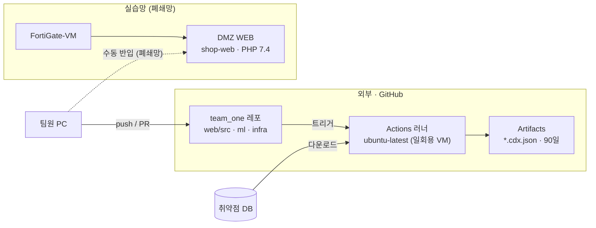
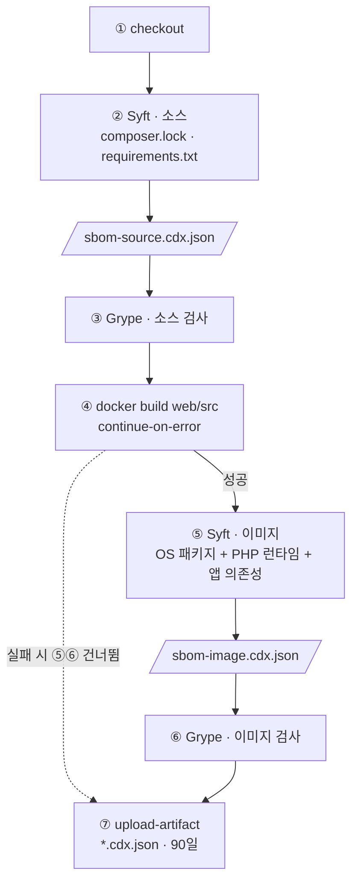
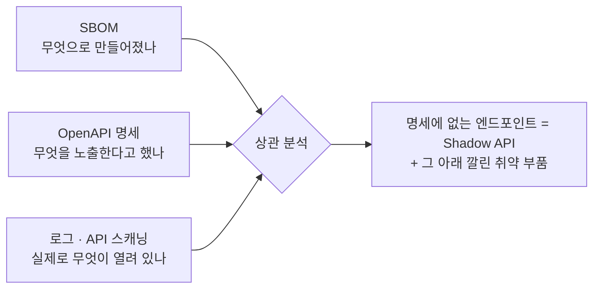
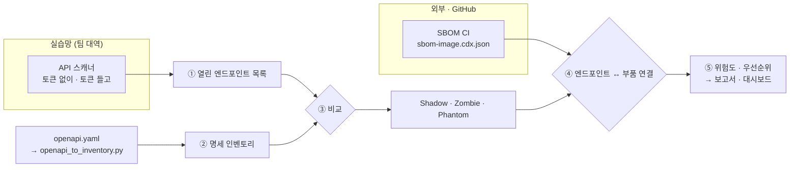

# SBOM — 소프트웨어 부품 목록 생성과 취약점 점검

> 작성: YHC · 기준일: 2026-11-01
> 워크플로: [`.github/workflows/sbom.yml`](../../.github/workflows/sbom.yml) (PR #16, 2026-10-29)
> 설계 방향: 멘토님 조언 — 소스 SBOM과 이미지 SBOM을 **둘 다** 만든다

---

## 1. 요약

코드가 main에 들어올 때마다 **GitHub Actions**가 **Syft**로 **CycloneDX** 형식의 SBOM을 두 개(소스 · 이미지) 만들고, **Grype**로 취약점을 검사한 뒤 결과 파일을 90일간 보관한다.

| 구성 요소 | 역할 |
|---|---|
| **CycloneDX** | 부품 목록을 적는 **표준 형식** (JSON). 도구가 아니라 양식 |
| **Syft** (`anchore/sbom-action`) | 양식을 **채우는 생성기** |
| **Grype** (`anchore/scan-action`) | 채워진 목록을 CVE DB와 대조하는 **스캐너** |
| **GitHub Actions** | 위 과정을 **자동 실행** |

**SBOM이란**: 소프트웨어에 들어간 부품(라이브러리 · 패키지)과 버전의 목록. 식품의 원재료 표시와 비슷하다.
- Log4Shell 같은 CVE가 나왔을 때 "우리 중 어디가 영향받나"를 바로 확인
- 라이선스 관리, 공급망 보안 · 규제 대응

---

## 2. 토폴로지 — SBOM은 어디서 만들어지나

SBOM 점검은 실습망(VMware) **밖, GitHub 서버**에서 돈다.
DMZ · LAN은 인터넷이 막혀 있어 취약점 DB를 받을 수 없기 때문이다 (`docs/troubleshooting/02`).



- **실선**: 자동으로 일어나는 흐름
- **점선**: 사람이 직접 옮기는 배포 — 자동 배포(CD)가 아니라 **CI (SBOM 점검)** 만 한다
- CI가 SBOM을 만드는 이미지와 WEB에 배포되는 이미지는 **같은 `web/src/Dockerfile`** 에서 나온다
  - ⚠️ WEB은 오프라인으로 빌드하므로 빌드 시점에 따라 OS 패키지 버전이 다를 수 있다

> 토폴로지 그림에 넣을 때: 방화벽 바깥(WAN 위)에 **"외부 (GitHub)"** 영역을 따로 그린다. DMZ · LAN 안에 넣으면 틀린 그림이다.

---

## 3. 동작

### 3-1. 언제 도나

| 이벤트 | 실행 |
|---|---|
| main 대상 PR 생성 · 커밋 추가 | ✅ |
| main 머지 | ✅ |
| Actions 화면 **Run workflow** | ✅ 수동 |
| 다른 브랜치에 푸시만 (PR 없음) | ❌ |

### 3-2. 단계



### 3-3. 왜 SBOM을 두 개 만드나

| | 소스 SBOM | 이미지 SBOM |
|---|---|---|
| 보는 대상 | 개발자가 **선언한** 의존성 | 실제 **배포물 전체** |
| 포함 | PHP · Python 라이브러리 | + OS 패키지(apt), PHP 7.4 런타임 |
| 놓치는 것 | 낡은 PHP 런타임, OS 취약점 | 없음 (대신 빌드가 실패할 수 있음) |

> "웹 서버에 낮은 버전 PHP가 있다"는 근거는 **이미지 SBOM에서만** 나온다.

### 3-4. 레포에서 잡히는 것

| 재료 | 위치 | SBOM에 잡히나 |
|---|---|---|
| PHP 라이브러리 | `web/src/composer.lock` | ✅ `firebase/php-jwt v6.10.0` |
| 웹 이미지 | `web/src/Dockerfile` (`php:7.4-apache`) | ✅ 빌드 후 OS 패키지까지 |
| ML 의존성 | `ml/requirements.txt` | ⚠️ 버전 범위(`>=`)만 있어 **정확한 버전이 안 잡힘** → 고정 파일(`pip freeze`) 필요 |

### 3-5. 안전장치

| 설정 | 의미 | 이후 |
|---|---|---|
| `fail-build: false` | 취약점이 있어도 막지 않고 리포트만 | 정리 후 `true` → High 이상 PR 차단 |
| `severity-cutoff: high` | High 이상 기준 | — |
| `continue-on-error: true` (이미지 빌드) | 지원 종료 베이스 이미지의 apt 문제로 빌드가 실패해도 소스 SBOM은 남김 | — |
| `permissions: contents: read` | 읽기 권한만 | — |

---

## 4. 결과

### 4-1. CI 실행 (2026-10-30)

| 실행 (KST) | 이벤트 | 결과 |
|---|---|---|
| 10/30 08:25 | `pull_request` | ✅ success |
| 10/30 08:45 | `push` (main 머지) | ✅ success |
| 10/30 10:05 | `workflow_dispatch` | ✅ success |

- 8단계 모두 성공, 이미지 빌드 성공 → **SBOM 2종 모두 생성**
- 결과 보는 곳: PR의 **sbom** 체크 → 단계별 기록에 취약점 표 / 실행 화면 하단 **Artifacts**에 SBOM 파일

### 4-2. 로컬 확인 (2026-10-30)

| 확인 | 결과 |
|---|---|
| actionlint (워크플로 문법) | 오류 없음 |
| 웹 이미지 빌드 | 성공 |
| 소스 SBOM | `firebase/php-jwt v6.10.0` + 워크플로가 쓰는 Actions 4개 |
| 이미지 SBOM | 부품 191개 (deb 187) |
| 이미지 취약점 | **Critical 56 / High 233** / Medium 208 / Low 35 / Negligible 706 |

- 대부분 베이스 이미지 **`php:7.4-apache`(지원 종료)** 에서 나온다
- 줄이려면 PHP 8.x 베이스로 올려야 한다 → 웹 코드 호환성 확인이 필요한 별도 작업
- 숫자는 취약점 DB 갱신에 따라 달라진다

---

## 5. 로컬에서 해 보기

```bash
# 설치 (Linux / WSL)
curl -sSfL https://raw.githubusercontent.com/anchore/syft/main/install.sh | sh -s -- -b /usr/local/bin
curl -sSfL https://raw.githubusercontent.com/anchore/grype/main/install.sh | sh -s -- -b /usr/local/bin

syft dir:web/src -o cyclonedx-json > sbom.cdx.json   # 부품 목록 생성
grype sbom:sbom.cdx.json                             # 취약점 검사
```

Docker만 있을 때 (Windows PowerShell)

```powershell
docker run --rm -v "D:/team_one:/repo:ro" anchore/syft:v1.18.1 dir:/repo -o cyclonedx-json -q > sbom-source.cdx.json
docker build -t shop-web:sbomtest web/src
docker run --rm -v //var/run/docker.sock:/var/run/docker.sock anchore/syft:v1.18.1 docker:shop-web:sbomtest -o cyclonedx-json -q > sbom-image.cdx.json
```

---

## 6. Shadow API 탐지와의 관계

SBOM은 **"무엇으로 만들어졌나"** 를 알려 줄 뿐, **"어떤 API가 열려 있나"** 는 알려 주지 않는다. Shadow API를 **직접 찾지는 않는다.**

대신 다른 출처와 합치면 **위험도를 매기는 재료**가 된다.



- **명세 vs 로그 · 스캔** → 명세에 없는 엔드포인트 = Shadow API 후보 (ELK · API 스캐닝)
- **+ SBOM** → 그 엔드포인트가 **지원 종료 런타임 · 취약 부품 위에서** 돌고 있는지까지 판단

---

## 7. 다음 단계

- [ ] High 이상 취약점 현황 정리 → `fail-build: true` 전환 검토
- [ ] `ml/requirements.txt` 버전 고정 (`pip freeze`) → ML 의존성도 정확히 잡히게
- [ ] 베이스 이미지 PHP 8.x 전환 시 영향 범위 정리 (웹 담당과 협의)
- [ ] SBOM ↔ OpenAPI 인벤토리 ↔ 로그 · 스캔 결과 상관 분석 → 8장

---

## 8. 향후 계획 — API 스캐닝과 결합

SBOM은 **"무엇으로 만들어졌나"**, API 스캐닝은 **"무엇이 열려 있나"** 를 알려 준다.
둘을 합치면 **"열려 있는 Shadow API가 어떤 취약 부품 위에서 돌고 있나"** 를 한 장으로 보고 **우선순위**를 매길 수 있다.

### 8-1. 흐름



| 단계 | 하는 일 | 입력 | 출력 |
|---|---|---|---|
| ① 스캔 | 서버에 실제로 열린 엔드포인트 찾기 (응답 코드 · 인증 필요 여부) | 스캐너 | `METHOD /path/{id}` 목록 |
| ② 명세 | 문서화된 엔드포인트 목록 | `openapi.yaml` | 같은 키 형식의 인벤토리 |
| ③ 비교 | `열린 것 − 명세 = Shadow`, `명세 − 열린 것 = Phantom` | ① ② | 분류 결과 |
| ④ 연결 | 엔드포인트를 **그것을 서비스하는 이미지의 SBOM**과 연결 | ③ + 이미지 SBOM | 엔드포인트별 런타임 · 라이브러리 · 취약점 수 |
| ⑤ 판정 | 노출 여부 × 인증 상태 × 부품 취약도로 우선순위 | ④ | JSON 보고서 → LLM 보고서 · 대시보드 |

- **공통 키**: 엔드포인트는 `METHOD /path/{id}` (ELK · 인벤토리와 같은 정규화 규칙)
- **연결 고리**: `openapi_to_inventory.py`의 `service` 값 → 그 서비스의 **이미지** → 이미지 SBOM
  - 지금은 쇼핑몰 이미지 하나(`web/src/Dockerfile`)가 v1 · v2를 모두 서비스한다 → 모든 엔드포인트가 같은 SBOM에 연결
  - 서비스가 여러 개로 나뉘면 엔드포인트별로 다른 SBOM이 붙는다

### 8-2. 시나리오 (현재 쇼핑몰 기준 예시)

| 엔드포인트 | ③ 분류 | 인증 | ④ 부품 (이미지 SBOM) | ⑤ 우선순위 |
|---|---|---|---|---|
| `GET /api/v1/diagnostics/ping` | **Shadow** | 토큰만 있으면 통과 | PHP 7.4 (지원 종료) · OS 패키지 · `ping` 실행 | 🔴 **최상** — 명령 실행 경로가 OS 패키지까지 닿음 |
| `GET /api/v1/users/{id}` | **Shadow** | 토큰만 확인 (인가 없음) | PHP 7.4 · `firebase/php-jwt` (인증 처리) | 🔴 **높음** — 개인정보 노출 + 인증 라이브러리 취약점이 있으면 위험 가중 |
| `GET /api/v2/products` | Documented | 공개 | 같은 이미지 | 🟢 낮음 — 관리 대상, 런타임 업그레이드 시 함께 해소 |

> 같은 런타임 취약점이라도 **명세에 없고 아무도 관리하지 않는 엔드포인트**가 먼저다. SBOM 단독으로는 이 순서를 정할 수 없고, 스캔 단독으로는 "왜 위험한지"를 설명할 수 없다.

### 8-3. 토폴로지상 결합 위치

- SBOM CI는 **GitHub(외부)** 에서, 스캐너는 **실습망 팀 대역 안**에서 돈다 (v1은 `V1_ALLOWED_NET`에서만 접근 가능)
- 결합은 **양쪽에 다 닿는 분석 PC**에서 한다
  - GitHub Actions **Artifacts**에서 `sbom-image.cdx.json` 내려받기
  - 스캔 결과 파일과 합쳐 ③ ~ ⑤ 실행
- 폐쇄망 원칙상 실습망 서버에서 GitHub로 직접 나가지 않는다

### 8-4. 단계별 계획

- [ ] API 스캐너 결과를 `METHOD /path/{id}` 키로 저장 (토큰 없이 · 토큰 들고 2회, 스캐너 IP 기록)
- [ ] 스캔 결과 − 명세 인벤토리 비교 스크립트 → Shadow · Zombie · Phantom
- [ ] 이미지 SBOM에서 런타임 버전 · 주요 라이브러리 · 심각도별 취약점 수 추출
- [ ] 엔드포인트별 위험도 규칙 정의 (노출 × 인증 × 부품 취약도)
- [ ] JSON 보고서 → LLM 보고서 · 대시보드 입력으로 연결
- [ ] (이후) ELK 로그를 출처로 추가 → "열려 있고 **실제로 호출되는**" Shadow API에 가중치
