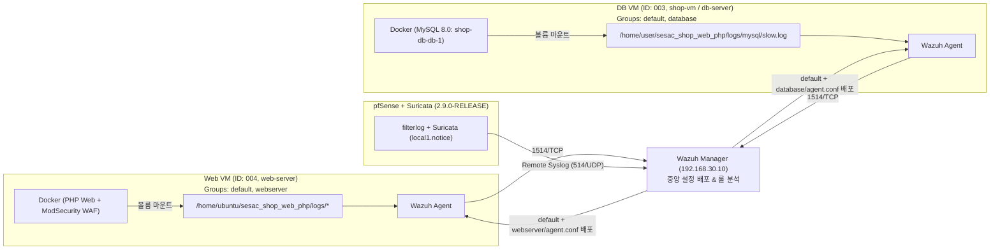

# Wazuh 통합 로그 수집 및 중앙 관리 구축 작업 기록서 (Web, DB, pfSense + Suricata)

> **작성일:** 2026-11-03  
> **목적:** 각 서버(Web, DB, 방화벽)마다 개별적으로 로그 수집 설정(`ossec.conf`)을 관리하던 번거로움을 없애고, **Wazuh 매니저(`192.168.30.10`) 한 곳에서 에이전트 그룹(`agent.conf`) 및 원격 Syslog를 통해 100% 중앙 집중식으로 통합 관리**하도록 전환한 점검 및 작업 내역입니다.

---

## 1. 사전 점검 결과 요약 (Before)

SSH를 통해 Web 서버, DB 서버, 방화벽(pfSense), Wazuh 매니저의 상태를 각각 점검한 결과는 다음과 같았습니다.

| 대상 장비 | 접속 및 식별 정보 | 구동 형태 및 실제 로그 위치 | 기존 설정 상태 및 문제점 |
|---|---|---|---|
| **Web 서버** | • IP: `192.168.20.10` (SSH 포트포워딩: `192.168.0.141:2222`, 계정 `ubuntu`)<br/>• 호스트명: `web-server`<br/>• **Agent ID: `004`** | • Docker(`compose.web.yml`)로 PHP(Apache) + ModSecurity WAF 구동<br/>• 호스트 마운트 경로: `/home/ubuntu/sesac_shop_web_php/logs/`<br/>  - `app.log`<br/>  - `apache/shop_access.log`, `apache/shop_error.log`<br/>  - `waf/modsec_audit.log`, `waf/error.log`, `waf/access.log` | • 로컬 `/var/ossec/etc/ossec.conf`에 수동으로 `<localfile>`이 작성되어 있었음<br/>• 매니저 중앙 설정(`/var/ossec/etc/shared/agent.conf`)은 비어 있었음 |
| **DB 서버** | • IP: `192.168.10.20` (계정 `user`)<br/>• 호스트명: `shop-vm` (`db-server`)<br/>• **Agent ID: `003`** | • Docker(`shop-db-db-1`, `mysql:8.0`)로 구동<br/>• 컨테이너 `/var/log/mysql`이 호스트 `/home/user/sesac_shop_web_php/logs/mysql`로 볼륨 마운트됨<br/>  - `slow.log` | • 호스트 `/var/log/mysql`이 아닌 도커 마운트 경로에 로그가 쌓이고 있었음<br/>• 로컬 `ossec.conf`에 DB 로그 수집 설정이 누락되어 있었음 |
| **방화벽** | • `pfSense 2.9.0-RELEASE`<br/>• 호스트명: `pfSense_firewall.private`<br/>• OS: `FreeBSD 16.0-CURRENT` | • pfSense 방화벽 로그: `/var/log/filter.log`<br/>• Suricata 로그:<br/>  - `/var/log/suricata/suricata_em053500/eve.json`<br/>  - `/var/log/suricata/suricata_em259556/eve.json` | • `FreeBSD 16.0-CURRENT` 기반이라 외부 `wazuh-agent` 패키지 설치 불가 (`wrong OS version: FreeBSD:16:amd64`)<br/>• `filterlog`는 이미 `@192.168.30.10:514`로 Syslog 전송 중이었으나, Suricata는 로컬 파일(`regular`)에만 저장 중이었음 |

---

## 2. 최종 통합 관리 아키텍처 (After)

1. **도커 컨테이너 로그 수집:** 컨테이너 내부에 에이전트를 설치하지 않고, 각 호스트 VM의 Wazuh 에이전트가 도커 볼륨 마운트 경로의 로그 파일을 직접 수집합니다.
2. **로컬 설정 초기화 + 매니저 100% 중앙 관리:** Web/DB 에이전트의 로컬 `/var/ossec/etc/ossec.conf`에서 `<localfile>`을 모두 삭제하고, 오직 매니저의 `/var/ossec/etc/shared/<그룹명>/agent.conf`에서만 로그 수집 경로를 관리합니다.
3. **방화벽 에이전트리스 연동:** pfSense는 에이전트 없이 원격 Syslog(`@192.168.30.10:514`)로 방화벽 로그(`filterlog`)와 Suricata 로그(`local1.notice`)를 모두 매니저에 전송합니다.



---

## 3. 단계별 수행 작업 내역

### 3-1. Web 서버 & DB 서버 로컬 `<localfile>` 설정 제거 (중복 수집 방지)
각 에이전트의 로컬 설정과 매니저의 중앙 설정이 충돌하거나 중복 수집되지 않도록, 로컬 `/var/ossec/etc/ossec.conf`를 백업한 뒤 모든 `<localfile>` 블록을 비웠습니다.

```bash
# [Web 서버(ubuntu@web-server) 및 DB 서버(user@db-server)에서 각각 실행]

# 1. 기존 설정 파일 백업
sudo cp /var/ossec/etc/ossec.conf /var/ossec/etc/ossec.conf.bak

# 2. ossec.conf 내 모든 <localfile> ~ </localfile> 구간 삭제
sudo sed -i '/<localfile>/,/<\/localfile>/d' /var/ossec/etc/ossec.conf

# 3. 삭제 확인 (출력 없음 확인) 및 에이전트 재시작
sudo grep "<localfile>" /var/ossec/etc/ossec.conf
sudo systemctl restart wazuh-agent
```

---

### 3-2. Wazuh 매니저(`wazuh-server`) 에이전트 그룹 생성 및 할당
Wazuh 매니저에서 `webserver` 그룹과 `database` 그룹을 생성하고 에이전트를 배정했습니다.
* Wazuh의 다중 그룹(Multi-group) 기능에 의해 각 에이전트는 공통 그룹(`default`)과 역할별 그룹(`webserver` 또는 `database`)의 설정을 합쳐서(`merged.mg`) 부여받습니다.

```bash
# [Wazuh 매니저(dongyoung@wazuh-server)에서 실행]

# 1. 그룹 생성
sudo /var/ossec/bin/agent_groups -a -g webserver -q
sudo /var/ossec/bin/agent_groups -a -g database -q

# 2. 에이전트 할당 (004: web-server -> webserver, 003: shop-vm -> database)
sudo /var/ossec/bin/agent_groups -a -i 004 -g webserver -q
sudo /var/ossec/bin/agent_groups -a -i 003 -g database -q

# 3. 그룹 목록 확인 결과
sudo /var/ossec/bin/agent_groups -l
# 출력:
# Groups (3):
#   database (1)
#   default (2)
#   webserver (1)
# Unassigned agents: 0.
```

---

### 3-3. Wazuh 매니저 그룹별 중앙 설정 파일(`agent.conf`) 작성 및 검증

#### ① 공통 그룹 설정 (`/var/ossec/etc/shared/default/agent.conf`)
Web 서버와 DB 서버 모두에 공통 적용되는 리눅스 시스템 로그(`auth.log`, `syslog`)와 도커 컨테이너 표준 입출력 로그(`/var/lib/docker/containers/*/*-json.log`)를 설정했습니다.

```bash
sudo tee /var/ossec/etc/shared/default/agent.conf > /dev/null << 'EOF'
<agent_config os="Linux">
  <!-- Linux Auth / SSH Login Log -->
  <localfile>
    <log_format>syslog</log_format>
    <location>/var/log/auth.log</location>
  </localfile>

  <!-- System Core Log -->
  <localfile>
    <log_format>syslog</log_format>
    <location>/var/log/syslog</location>
  </localfile>

  <!-- Docker Container Stdout/Stderr JSON Logs (Web & DB 공통) -->
  <localfile>
    <log_format>json</log_format>
    <location>/var/lib/docker/containers/*/*-json.log</location>
  </localfile>
</agent_config>
EOF
```

#### ② 웹서버 그룹 설정 (`/var/ossec/etc/shared/webserver/agent.conf`)
`web-server`(`004`)에만 배포되는 설정으로, 도커 볼륨 마운트 경로(`/home/ubuntu/sesac_shop_web_php/logs/`)의 PHP 앱 로그, Apache 접근/에러 로그, ModSecurity WAF 감사/에러/접근 로그 6종을 설정했습니다.

```bash
sudo tee /var/ossec/etc/shared/webserver/agent.conf > /dev/null << 'EOF'
<agent_config os="Linux">
  <!-- 1. PHP 쇼핑몰 애플리케이션 로그 (JSON) -->
  <localfile>
    <log_format>json</log_format>
    <location>/home/ubuntu/sesac_shop_web_php/logs/app.log</location>
  </localfile>

  <!-- 2. 도커 PHP-Apache 접근 및 에러 로그 -->
  <localfile>
    <log_format>apache</log_format>
    <location>/home/ubuntu/sesac_shop_web_php/logs/apache/shop_access.log</location>
  </localfile>
  <localfile>
    <log_format>apache</log_format>
    <location>/home/ubuntu/sesac_shop_web_php/logs/apache/shop_error.log</location>
  </localfile>

  <!-- 3. 도커 ModSecurity WAF 감사 로그(JSON) 및 에러/접근 로그 -->
  <localfile>
    <log_format>json</log_format>
    <location>/home/ubuntu/sesac_shop_web_php/logs/waf/modsec_audit.log</location>
  </localfile>
  <localfile>
    <log_format>apache</log_format>
    <location>/home/ubuntu/sesac_shop_web_php/logs/waf/error.log</location>
  </localfile>
  <localfile>
    <log_format>apache</log_format>
    <location>/home/ubuntu/sesac_shop_web_php/logs/waf/access.log</location>
  </localfile>
</agent_config>
EOF
```

#### ③ DB서버 그룹 설정 (`/var/ossec/etc/shared/database/agent.conf`)
`shop-vm`(`003`, `db-server`)에만 배포되는 설정으로, 도커 MySQL 컨테이너(`shop-db-db-1`)에서 호스트로 마운트된 `/home/user/sesac_shop_web_php/logs/mysql/slow.log`를 설정했습니다.

```bash
sudo tee /var/ossec/etc/shared/database/agent.conf > /dev/null << 'EOF'
<agent_config os="Linux">
  <!-- 도커 MySQL Slow / Query Log -->
  <localfile>
    <log_format>mysql_log</log_format>
    <location>/home/user/sesac_shop_web_php/logs/mysql/slow.log</location>
  </localfile>
</agent_config>
EOF
```

#### ④ 권한 부여, 문법 검증 및 매니저 재시작
```bash
# 파일 소유권 및 권한 설정
sudo sh -c 'chown wazuh:wazuh /var/ossec/etc/shared/*/agent.conf && chmod 660 /var/ossec/etc/shared/*/agent.conf'

# 문법 검증 실행 결과:
sudo /var/ossec/bin/verify-agent-conf
# verify-agent-conf: Verifying [etc/shared/webserver/agent.conf] -> OK
# verify-agent-conf: Verifying [etc/shared/database/agent.conf]  -> OK
# verify-agent-conf: Verifying [etc/shared/default/agent.conf]   -> OK

# 매니저 재시작하여 즉시 설정 배포
sudo systemctl restart wazuh-manager

# 에이전트 동기화 상태(synced) 확인
sudo /var/ossec/bin/agent_groups -S -i 004
sudo /var/ossec/bin/agent_groups -S -i 003
```

---

### 3-4. 방화벽 (`pfSense` + `Suricata`) 원격 Syslog 설정

1. **pfSense 기본 방화벽 로그 (`filterlog`):**
   * `/var/etc/syslog.d/pfSense.conf`에 이미 아래와 같이 Wazuh 매니저(`192.168.30.10:514`)로 원격 전송 설정되어 있음을 확인했습니다:
     ```text
     !filterlog
     *.*                                                             /var/log/filter.log
     *.*                                                             @192.168.30.10:514
     ...
     *.emerg;*.notice;kern.debug;lpr.info;mail.crit;news.err;local0.none;local3.none;local4.none;local7.none;security.*;auth.info;authpriv.info;daemon.notice        @192.168.30.10:514
     ```
2. **Suricata 로그 (`em0`, `em2` 인터페이스) Syslog 연동:**
   * 위 `pfSense.conf`에서 `local1.notice`는 제외(`none`)되지 않고 `@192.168.30.10:514`로 전송되도록 열려 있으므로, pfSense 웹 UI(`Services` -> `Suricata` -> `Interfaces` -> `em0`, `em2` 편집)에서 아래와 같이 설정합니다:
     * **Send Alerts to System Log**: 체크 (`Log Facility: LOCAL1`, `Log Priority: NOTICE`)
     * **EVE Output Mode**: `Syslog` (`EVE Syslog Output Facility: LOCAL1`, `EVE Syslog Output Priority: NOTICE`)
   * 설정 저장 후 Suricata 인터페이스를 재시작하면 Suricata 이벤트도 `192.168.30.10:514`로 통합 전송됩니다.

---

## 4. 향후 운영 및 유지보수 치트시트

앞으로 로그 수집 경로를 추가하거나 변경할 때는 각 서버에 접속할 필요 없이 **`wazuh-server` (`192.168.30.10`)에서만** 아래 파일을 수정하면 됩니다.

* **웹서버 로그 추가/변경 시:** `sudo nano /var/ossec/etc/shared/webserver/agent.conf`
* **DB서버 로그 추가/변경 시:** `sudo nano /var/ossec/etc/shared/database/agent.conf`
* **공통 리눅스 로그 추가/변경 시:** `sudo nano /var/ossec/etc/shared/default/agent.conf`
* **탐지 룰(Rule) 추가/변경 시:** `sudo nano /var/ossec/etc/rules/local_rules.xml`
* **설정 수정 후 문법 검사 명령어:** `sudo /var/ossec/bin/verify-agent-conf`
